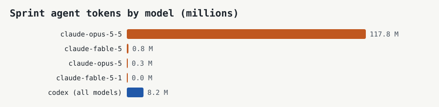
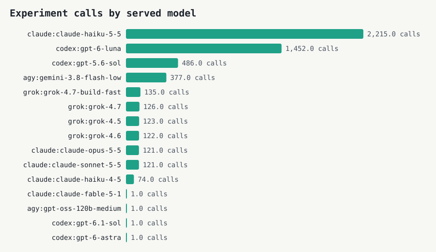

# Sprint token and cost log

Append-only. Each section is one snapshot written by `scripts/snapshot_usage.py`. Sprint project only: agent sessions in this project and the market agents' calls through the proxy. Costs are API-equivalent list prices; the work ran on flat subscriptions.

## Snapshot 2026-10-24 12:51

Sprint agent work: **119.9 M tokens**, **$51.62** at API list prices, from 2 machines. Experiment calls through the proxy: **3479**.

| Machine (anonymous) | Measured | Claude Code (M tokens) | Codex (M tokens) | Cost (USD, list) | Method |
|---|---|---|---|---|---|
| box | 2026-10-23 18:55 | 69.3 | 8.2 | 37.00 | Whole-machine ledger snapshot of the sprint box, which works only on this sprint (Claude Code and Codex); measured on the box before per-project measurement existed |
| m-26cc32 | 2026-10-24 12:51 | 42.4 | 0.0 | 14.62 | Claude Code sessions in this project's folder (1 sessions), priced by ccusage@20.0.43 |

| Model | Tokens (M) | Cost (USD, list) |
|---|---|---|
| claude-opus-5-5 | 110.6 | 41.19 |
| claude-fable-5 | 0.8 | 4.18 |
| claude-opus-5 | 0.3 | 0.68 |
| claude-fable-5-1 | 0.0 | 0.65 |

| Experiment calls, served model | Calls | Tokens (estimated) |
|---|---|---|
| claude:claude-haiku-5-5 | 1735 | 3,646,451 |
| codex:gpt-6-luna | 442 | 351,980 |
| agy:gemini-3.8-flash-low | 377 | 705,956 |
| grok:grok-4.7-build-fast | 134 | 140,481 |
| grok:grok-4.5 | 122 | 104,754 |
| grok:grok-4.6 | 122 | 105,002 |
| claude:claude-opus-5-5 | 121 | 103,574 |
| claude:claude-sonnet-5-5 | 121 | 105,209 |
| codex:gpt-5.6-sol | 121 | 91,003 |
| grok:grok-4.7 | 109 | 109,574 |
| claude:claude-haiku-4-5 | 74 | 63,431 |
| claude:claude-fable-5-1 | 1 | 8 |

## Snapshot 2026-10-24 13:00

Sprint agent work: **127.1 M tokens**, **$53.52** at API list prices, from 2 machines. Experiment calls through the proxy: **3493**.

| Machine (anonymous) | Measured | Claude Code (M tokens) | Codex (M tokens) | Cost (USD, list) | Method |
|---|---|---|---|---|---|
| box | 2026-10-23 18:55 | 69.3 | 8.2 | 37.00 | Whole-machine ledger snapshot of the sprint box, which works only on this sprint (Claude Code and Codex); measured on the box before per-project measurement existed |
| m-26cc32 | 2026-10-24 13:00 | 49.6 | 0.0 | 16.52 | Claude Code sessions in this project's folder (1 sessions), priced by ccusage@20.0.43 |

| Model | Tokens (M) | Cost (USD, list) |
|---|---|---|
| claude-opus-5-5 | 117.8 | 43.09 |
| claude-fable-5 | 0.8 | 4.18 |
| claude-opus-5 | 0.3 | 0.68 |
| claude-fable-5-1 | 0.0 | 0.65 |

| Experiment calls, served model | Calls | Tokens (estimated) |
|---|---|---|
| claude:claude-haiku-5-5 | 1735 | 3,646,451 |
| codex:gpt-6-luna | 442 | 351,980 |
| agy:gemini-3.8-flash-low | 377 | 705,956 |
| grok:grok-4.7-build-fast | 134 | 140,481 |
| grok:grok-4.7 | 123 | 117,517 |
| grok:grok-4.5 | 122 | 104,754 |
| grok:grok-4.6 | 122 | 105,002 |
| claude:claude-opus-5-5 | 121 | 103,574 |
| claude:claude-sonnet-5-5 | 121 | 105,209 |
| codex:gpt-5.6-sol | 121 | 91,003 |
| claude:claude-haiku-4-5 | 74 | 63,431 |
| claude:claude-fable-5-1 | 1 | 8 |

## Snapshot 2026-10-24 17:23

Sprint agent work: **160.9 M tokens**, **$64.92** at API list prices, from 2 machines. Experiment calls through the proxy: **3911**.

| Machine (anonymous) | Measured | Claude Code (M tokens) | Codex (M tokens) | Cost (USD, list) | Method |
|---|---|---|---|---|---|
| box | 2026-10-23 18:55 | 69.3 | 8.2 | 37.00 | Whole-machine ledger snapshot of the sprint box, which works only on this sprint (Claude Code and Codex); measured on the box before per-project measurement existed |
| m-26cc32 | 2026-10-24 17:23 | 83.4 | 0.0 | 27.92 | Claude Code sessions in this project's folder (1 sessions), priced by ccusage@20.0.43 |

| Model | Tokens (M) | Cost (USD, list) |
|---|---|---|
| claude-opus-5-5 | 151.6 | 54.49 |
| claude-fable-5 | 0.8 | 4.18 |
| claude-opus-5 | 0.3 | 0.68 |
| claude-fable-5-1 | 0.0 | 0.65 |

| Experiment calls, served model | Calls | Tokens (estimated) |
|---|---|---|
| claude:claude-haiku-5-5 | 1854 | 3,810,449 |
| codex:gpt-6-luna | 730 | 689,862 |
| agy:gemini-3.8-flash-low | 377 | 705,956 |
| grok:grok-4.7-build-fast | 135 | 140,487 |
| grok:grok-4.7 | 126 | 117,639 |
| codex:gpt-5.6-sol | 124 | 91,119 |
| grok:grok-4.5 | 123 | 104,760 |
| grok:grok-4.6 | 122 | 105,002 |
| claude:claude-opus-5-5 | 121 | 103,574 |
| claude:claude-sonnet-5-5 | 121 | 105,209 |
| claude:claude-haiku-4-5 | 74 | 63,431 |
| claude:claude-fable-5-1 | 1 | 8 |
| agy:gpt-oss-120b-medium | 1 | 6 |
| codex:gpt-6.1-sol | 1 | 54 |
| codex:gpt-6-astra | 1 | 58 |

## Snapshot 2026-10-24 18:17

Sprint agent work: **193.6 M tokens**, **$73.93** at API list prices, from 2 machines. Experiment calls through the proxy: **5356**.

| Machine (anonymous) | Measured | Claude Code (M tokens) | Codex (M tokens) | Cost (USD, list) | Method |
|---|---|---|---|---|---|
| box | 2026-10-23 18:55 | 69.3 | 8.2 | 37.00 | Whole-machine ledger snapshot of the sprint box, which works only on this sprint (Claude Code and Codex); measured on the box before per-project measurement existed |
| m-26cc32 | 2026-10-24 18:17 | 116.1 | 0.0 | 36.93 | Claude Code sessions in this project's folder (1 sessions), priced by ccusage@20.0.43 |

| Model | Tokens (M) | Cost (USD, list) |
|---|---|---|
| claude-opus-5-5 | 184.3 | 63.50 |
| claude-fable-5 | 0.8 | 4.18 |
| claude-opus-5 | 0.3 | 0.68 |
| claude-fable-5-1 | 0.0 | 0.65 |

| Experiment calls, served model | Calls | Tokens (estimated) |
|---|---|---|
| claude:claude-haiku-5-5 | 2215 | 4,561,590 |
| codex:gpt-6-luna | 1452 | 2,162,984 |
| codex:gpt-5.6-sol | 486 | 827,012 |
| agy:gemini-3.8-flash-low | 377 | 705,956 |
| grok:grok-4.7-build-fast | 135 | 140,487 |
| grok:grok-4.7 | 126 | 117,639 |
| grok:grok-4.5 | 123 | 104,760 |
| grok:grok-4.6 | 122 | 105,002 |
| claude:claude-opus-5-5 | 121 | 103,574 |
| claude:claude-sonnet-5-5 | 121 | 105,209 |
| claude:claude-haiku-4-5 | 74 | 63,431 |
| claude:claude-fable-5-1 | 1 | 8 |
| agy:gpt-oss-120b-medium | 1 | 6 |
| codex:gpt-6.1-sol | 1 | 54 |
| codex:gpt-6-astra | 1 | 58 |

